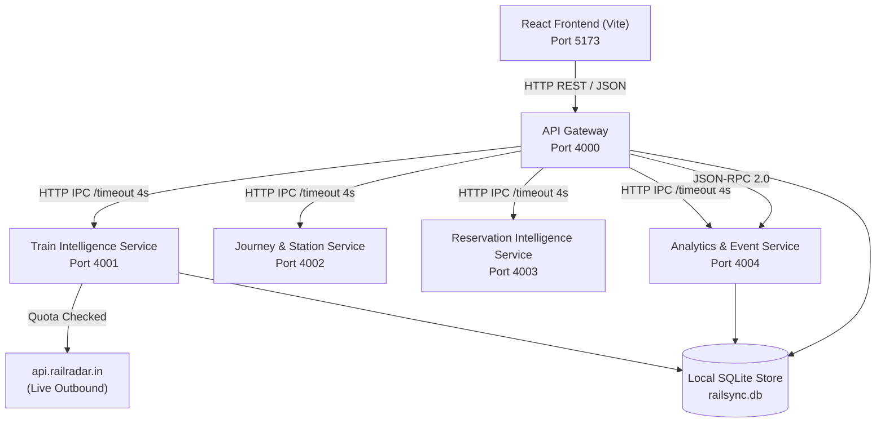

# RailSync — Distributed Railway Intelligence & Monitoring Platform

**RailSync** is a modular, multi-process distributed systems application built for the **Distributed Computing Systems (DCS)** curriculum. It serves as a unified railway information, live telemetry monitoring, journey planning, reservation intelligence, and failure-resilient platform integrating the **RailRadar API** with strict quota governance.

---

## 1. Abstract & Problem Statement
Modern railway operations demand real-time telemetry, timetable synchronization, dynamic delay forecasting, and multi-leg journey planning across heterogeneous systems. However, real-world public railway APIs enforce strict consumption limits (e.g., RailRadar sandbox quota of **100 requests per month**). A naive single-process frontend or monolithic backend that polls on render quickly exhausts upstream quotas, lacks fault isolation, and suffers from single points of failure.

RailSync addresses this by implementing:
1. **A genuine distributed services architecture**: 5 independent backend processes communicating exclusively over HTTP/JSON Inter-Process Communication (IPC).
2. **Strict Quota & Budget Management**: A governor enforcing an 80-request internal cap, a 20-request emergency buffer, and automated in-memory and SQLite-backed TTL caching.
3. **Graceful Fault Degradation & Self-Healing**: Real-time simulated 503 fault-injection demonstrations proving that isolated service outages do not crash unaffected modules.
4. **Transparent Data Provenance**: Distinct visual badges for `LIVE_PROVIDER_DATA`, `CACHED_PROVIDER_DATA`, `LOCAL_HISTORICAL_OBSERVATION`, and `SIMULATED_DEMO_DATA`.

---

## 2. Distributed Architecture



### Logical Services & Port Allocations
| Service | Port | Entrypoint | Primary Responsibility |
|---|---|---|---|
| **React Frontend** | `5173` | `client/src/main.tsx` | Dashboard, telemetry map, reservation tools, fault injection UI |
| **API Gateway** | `4000` | `services/gateway/server.ts` | Routing, data aggregation, 4s timeouts, cluster health, quota proxy |
| **Train Intelligence** | `4001` | `services/train-intel/server.ts` | Live tracking, timetable, geometry, coach layouts, RailRadar adapter |
| **Journey & Station** | `4002` | `services/journey-station/server.ts` | Route planning, station schedule, live departures, suburban network |
| **Reservation Intelligence**| `4003` | `services/reservation/server.ts` | Seat availability, telescopic fares, PNR status, waitlist prediction |
| **Analytics & Event** | `4004` | `services/analytics/server.ts` | Delay trend analysis, station disruption simulator, JSON-RPC 2.0 |

---

## 3. Strict Quota Protection Policy
- **Sandbox Limit**: 100 requests per calendar month.
- **Internal Safe Cap**: 80 requests per month.
- **Emergency Reserve**: 20 requests strictly reserved for manual final viva verification.
- **Zero Startup Polling**: No API calls are made when services launch or pages render.
- **In-Flight Deduplication**: Concurrent identical queries share a single in-flight Promise to avoid duplicate upstream consumption.
- **TTL Caching**:
  - Live train status: 120 seconds.
  - Timetables & station schedules: 24 hours.
  - Route geometry & directories: 7 days.
- **Default Operational Flags**:
  - `DEMO_MODE=true`
  - `LIVE_API_ENABLED=false`

---

## 4. Technologies Used
- **Frontend**: React 18, Vite, TypeScript, Tailwind CSS, Lucide React, Recharts, Leaflet.
- **Backend**: Node.js v22 (Native `node:sqlite` embedded DatabaseSync), Express, TypeScript via `tsx`.
- **Inter-Process Communication**: Native HTTP/JSON fetch with AbortSignal timeouts and JSON-RPC 2.0.
- **Process Management**: `concurrently` starting all 5 backend nodes and client simultaneously.

---

## 5. Installation & Setup

### 1. Clone repository & configure environment:
```bash
cp .env.example .env
```
Default `.env` configuration:
```ini
DEMO_MODE=true
LIVE_API_ENABLED=false
RAILRADAR_API_KEY=
RAILRADAR_BASE_URL=https://api.railradar.in
RAILRADAR_MONTHLY_LIMIT=100
RAILRADAR_INTERNAL_BUDGET=80
RAILRADAR_TIMEZONE=Asia/Kolkata
GATEWAY_PORT=4000
TRAIN_SERVICE_PORT=4001
JOURNEY_SERVICE_PORT=4002
RESERVATION_SERVICE_PORT=4003
ANALYTICS_SERVICE_PORT=4004
CLIENT_PORT=5173
SQLITE_DB_PATH=./data/db/railsync.db
```

### 2. Install dependencies:
```bash
npm install
npm --prefix client install
```

### 3. Run all services & client with a single command:
```bash
npm run dev
```
Open **[http://localhost:5173](http://localhost:5173)** in your browser.

---

## 6. Testing & Build
All test suites run completely offline without issuing any network calls:
```bash
# Run automated DCS smoke tests
npm test

# Build production bundle
npm run build
```

---

## 7. Known Limitations
1. RailRadar free sandbox does not provide live GPS coordinates for every local passenger train; static route geometry coordinates are used for unequipped rakes.
2. PNR status retrieval in demo mode operates on deterministic synthetic passenger records; real PNR numbers are never stored in databases or logs for passenger privacy.
3. The cluster is currently configured for localhost inter-process communication on separate ports; cross-machine networking can be enabled by configuring IP hostnames in `.env`.
