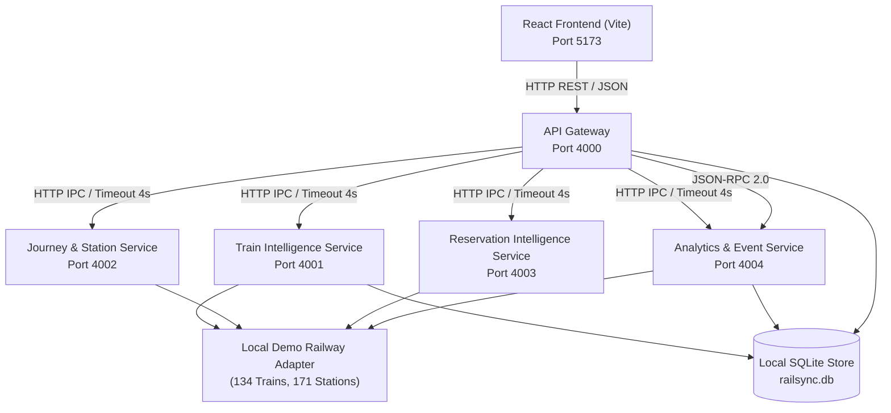

# RailSync — Distributed Railway Intelligence & Monitoring Platform
## Complete Offline Local Demonstration Edition

**RailSync** is a modular, multi-process distributed systems application built for the **Distributed Computing Systems (DCS)** curriculum. It serves as a unified railway information, live telemetry monitoring, journey planning, reservation intelligence, and failure-resilient platform operating in **100% offline local demo mode** with zero external API dependencies.

---

## 1. Abstract & Architecture Highlights
Modern railway operations demand real-time telemetry, timetable synchronization, dynamic delay forecasting, and multi-leg journey planning across heterogeneous systems. RailSync demonstrates a production-grade distributed architecture while operating completely offline:

1. **Genuine 5-Process Distributed Microservices**: 5 independent Node.js backend processes communicating exclusively over HTTP/JSON Inter-Process Communication (IPC) on independent network ports.
2. **100% Offline Local Railway Dataset**: Backed by comprehensive Indian Railways local JSON fixtures (134 trains, 171 stations, 134 route associations, 30 reservations, 25 coach layouts, 35 platform positions, 58 suburban services, 26 freight rakes, 210 delay snapshots, and 20 incident examples).
3. **Deterministic Telemetry Simulation**: Train positions advance along routes, speeds vary realistically, delays fluctuate gradually, and state transitions (approaching, halted, en-route, arrived) occur reliably with a simulation clock.
4. **Honest Architectural Representation**: Clear visual badges (`LOCAL_JSON_FIXTURE`, `LOCAL_SIMULATION`, `SIMULATED_PROVIDER_RESPONSE`, `LOCAL_CACHE`, `UNAVAILABLE`). Never mislabels local simulation as live provider data.
5. **Interactive Mock Provider Sandbox**: An interactive console in the API Registry allowing examiners to test any documented railway endpoint with simulated response times, request trace IDs, and HTTP status codes (200, 404, 429, 503).
6. **Graceful Fault Degradation & Self-Healing**: Real-time simulated 503 fault-injection demonstrations proving that isolating or crashing a service node does not take down unaffected microservices.

---

## 2. Distributed Architecture Diagram



### Genuine Inter-Service IPC vs Simulated External Provider
- **Genuine Inter-Service HTTP Requests**: All communication between the API Gateway (`port 4000`) and the microservices (`4001`, `4002`, `4003`, `4004`) consists of real HTTP/1.1 requests serialized into JSON byte buffers, transmitted across TCP loopback sockets, subject to strict `4000ms` AbortSignal deadlines and fault tolerance.
- **Simulated External Provider Responses**: No outbound calls are ever made to external services (such as `api.railradar.in`). Instead, `DemoRailwayAdapter` intercepts provider queries locally, serving realistic API-shaped responses from verified fixtures and simulation logic with explicit `SIMULATED_PROVIDER_RESPONSE` provenance tags.

---

## 3. Logical Services & Port Allocations
| Service | Port | Entrypoint | Primary Responsibility |
|---|---|---|---|
| **React Frontend** | `5173` | `client/src/main.tsx` | Dashboard, telemetry map, reservation tools, fault injection UI |
| **API Gateway** | `4000` | `services/gateway/server.ts` | Routing, request aggregation, 4s timeouts, cluster health, quota proxy |
| **Train Intelligence** | `4001` | `services/train-intel/server.ts` | Live tracking simulation, timetable, geometry, coach layouts, directories |
| **Journey & Station** | `4002` | `services/journey-station/server.ts` | Route planning, station schedule, live departures, suburban network |
| **Reservation Intelligence**| `4003` | `services/reservation/server.ts` | Seat availability, telescopic fares, PNR status, waitlist prediction, refunds |
| **Analytics & Event** | `4004` | `services/analytics/server.ts` | Delay trend analysis, station disruption simulator, JSON-RPC 2.0 |

---

## 4. Local Dataset Summary
All data is stored in modular JSON fixtures under `data/fixtures/`:
- **Stations (`stations.json`)**: 171 major Indian railway junctions with accurate GPS coordinates, platform counts, and zones.
- **Trains (`trains.json`)**: 134 recognizable services (Vande Bharat, Rajdhani, Shatabdi, Duronto, Superfast, Mail/Express).
- **Routes (`routes.json`)**: 134 complete ordered halt sequences with arrival/departure timings and cumulative distance.
- **Live Status (`live-status.json`)**: 65 pre-configured live telemetry states.
- **Coach Layouts (`coach-layouts.json`)**: 25 coach compositions with class berth capacities and FOB alignment.
- **Platform Positions (`platform-positions.json`)**: 35 station-train platform alignments.
- **Suburban Trains (`suburban.json`)**: 58 commuter EMU/MEMU services across Mumbai, Delhi, Chennai, and Bengaluru.
- **Freight Trains (`freight.json`)**: 26 freight rakes across WDFC, EDFC, and Golden Quadrilateral grids.
- **Historical Delay Observations (`delay-history.json`)**: 210 multi-day delay snapshots feeding trend analytics.
- **Disruptions & Incidents (`disruptions.json`)**: 20 operational incident scenarios with DCS impact mappings.

---

## 5. Installation & Starting the Application

### 1. Environment Setup
The project is pre-configured for offline operation:
```bash
# Verify environment configuration (pre-configured for offline mode)
cat .env
```

Key environment settings:
```ini
DEMO_MODE=true
LIVE_API_ENABLED=false
GATEWAY_PORT=4000
TRAIN_SERVICE_PORT=4001
JOURNEY_SERVICE_PORT=4002
RESERVATION_SERVICE_PORT=4003
ANALYTICS_SERVICE_PORT=4004
CLIENT_PORT=5173
SQLITE_DB_PATH=./data/db/railsync.db
```

### 2. Install dependencies:
```bash
npm install
npm --prefix client install
```

### 3. Run all 5 microservices & client with a single command:
```bash
npm run dev
```
Open **[http://localhost:5173](http://localhost:5173)** in your browser.

> **Testing Cheatsheet**: See [TEST_CHEATSHEET.md](file:///Users/ishan/dcs-mp/TEST_CHEATSHEET.md) for quick-reference test values (train numbers, station pairs, PNRs, coach layouts) to test every view.

---

## 6. Verification & Automated Test Suite
To verify the complete offline platform:
```bash
# Run automated offline test suite (45 automated checks)
npm test

# Build production bundle
npm run build
```

---

## 7. Security & Anti-External Network Protection
- **Zero External API Calls**: The test suite actively intercepts all network requests using a network security guard, failing immediately if any code attempts to contact `api.railradar.in` or external servers.
- **Permanent Offline Lock**: Administrative toggles are locked in offline mode. No frontend action or backend request can reactivate external API access.
- **Zero Secrets in Code/Logs**: All API keys have been removed from source code, `.env`, and runtime logs.
